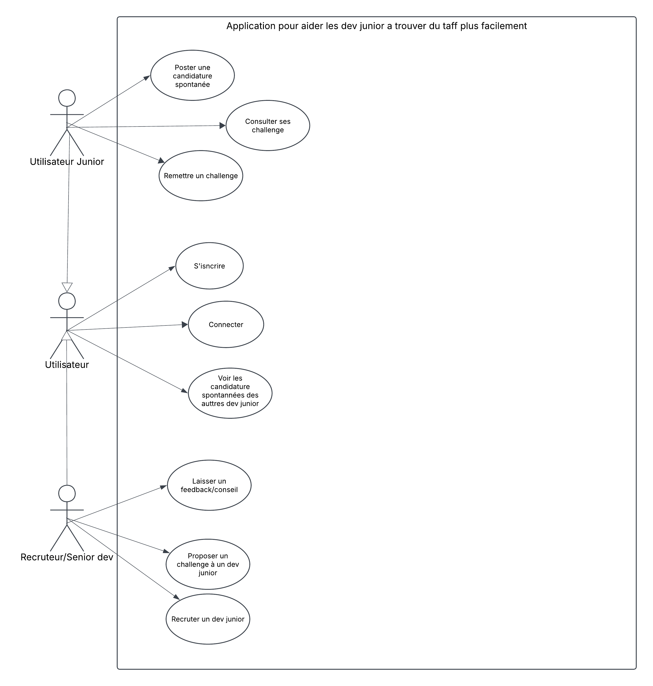

# Junior Launchpad 🚀

Moi-même récemment diplômé en dev web et actuellement en train de chercher mon premier poste dans un marché assez bouché pour les profils juniors, je me suis rendu compte de la galère : des centaines de candidatures envoyées dans le vide pour des offres qui demandent souvent déjà plusieurs années d'expérience.

J'ai donc décidé de concevoir et développer cette plateforme pour inverser un peu la tendance. 

## 💡 Le concept

L'idée est simple :
* **Candidature inversée** : C'est le dev junior qui publie son profil, ses projets concrets et sa stack technique.
* **Côté recruteurs / leads** : Les recruteurs parcourent les profils selon leurs besoins. Mieux encore : les développeurs seniors, lead devs ou CTO qui ont un peu de temps peuvent proposer un petit challenge technique concret (sur 1 à 2 semaines) à un junior pour combler d'éventuels manques, évaluer son niveau sur du vrai code et déboucher sur un recrutement direct dans leur équipe.
* Tout le monde y gagne : le junior a une vraie opportunité de montrer ce qu'il sait faire sans être bloqué par un filtre de CV automatique, et l'entreprise teste les compétences réelles du candidat.

## 📐 Conception

### Cas d'utilisation (Use Case)

### Diagramme de classes

## 🛠️ Stack technique

* **Langage** : Java 21
* **Framework** : Spring Boot 3 (Spring Web, Spring Data JPA, Bean Validation)
* **Base de données** : PostgreSQL (hébergé sur Supabase)
* **Outils** : Maven, Lombok

## 📌 En cours de développement

* [x] Conception UML (Use Case & Classes)
* [x] Initialisation du projet Spring Boot
* [ ] Modélisation et implémentation des entités JPA
* [ ] Configuration de la base de données Supabase
* [ ] Création des repositories et des services CRUD
* [ ] Documentation des endpoints avec Swagger (OpenAPI)
* [ ] Gestion de la sécurité et de l'authentification